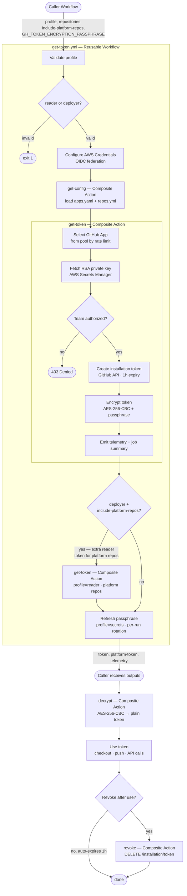

# action-ci-token

`Copyright (c) MAPFRE DevOps Platform`

[](https://github.com/mapfre-tech/action-ci-token/releases/tag/v1.2.1)
[](./CONTRIBUTING.md)
[](https://github.com/mapfre-tech/action-ci-token/actions/workflows/self-test.yml)
[](https://github.com/mapfre-tech/action-ci-token)
[](https://github.com/features/actions)

## 📋 Overview

Centralized CI token provider for GitHub Actions workflows. Generates **scoped, ephemeral installation tokens** from a pool of GitHub Apps, with authorization controls and rate limit pooling.

| Attribute | Value |
|---|---|
| **Type** | Reusable Workflow |
| **Authentication** | AWS OIDC federation (no GitHub secrets needed for AWS) |
| **Secrets storage** | AWS Secrets Manager |
| **Token encryption** | AES-256-CBC with per-repo rotating passphrase |
| **Token lifetime** | 1 hour (auto-expires) |
| **Rate limit** | 15,000 req/hour per GitHub App (Enterprise Cloud) |
| **Profiles** | `reader`, `deployer`, `secrets` |
| **Authorization** | Team membership (`-own` / `-mnt` / `-ctb` / `-dev` + `-adm`) |
| **Token Scope** | Requested repos (Default caller repo) + Platform Repos (Read only) |
| **Supply chain** | Python deps pinned with SHA-256 hashes (`--require-hashes`) |
| **Key handling** | RSA private keys fetched at runtime from Secrets Manager — never written to `GITHUB_ENV` |

---

## 📁 Project Structure

```
action-ci-token/
├── .github/workflows/
│   ├── get-token.yml          # Reusable workflow (entry point)
│   └── self-test.yml          # PR self-test workflow
├── internal/
│   ├── get-config/
│   │   ├── action.yml         # Composite action: load config
│   │   └── config/
│   │       ├── apps.yaml      # GitHub App pool configuration
│   │       └── repos.yml      # Platform repositories list
│   └── get-token/
│       ├── action.yml         # Composite action: generate token
│       ├── get-token.py       # Token generation logic
│       └── requirements.txt   # Pinned Python dependencies (SHA-256)
├── decrypt/
│   └── action.yml             # Composite action: decrypt token
├── revoke/
│   └── action.yml             # Composite action: revoke token
└── test/
    ├── local-test.sh          # Local scenario runner
    └── scenarios/             # *.env files, one per test case
```

---

## ✅ Prerequisites

Before calling this workflow, your repository must have:

1. **`GH_TOKEN_ENCRYPTION_PASSPHRASE` secret** — a repository or organization secret
   used to encrypt/decrypt the generated token. You can bootstrap it automatically
   by calling the workflow with `profile: secrets` (requires `-adm` team membership),
   or set it manually via the repo settings.

2. **AWS OIDC trust** — the workflow assumes the IAM role
   `arn:aws:iam::767397814329:role/github-actions-ci-token` via OIDC.
   Your repository must be authorized to assume it — contact the DevOps Platform
   team if access is not yet granted.

3. **Team membership** — some profiles require membership in a MAPFRE GitHub team:
   - `reader` on the default caller repo: no team membership required.
   - `reader` scoped to other repos: requires any membership (`-own`, `-mnt`, `-ctb`, or `-dev`).
   - `deployer`: requires `-own` or `-mnt` membership.

---

## ⚙️ Workflows

### Workflow: `.github/workflows/get-token.yml`

<!-- action-docs-all source=".github/workflows/get-token.yml" project="mapfre-tech/action-ci-token/.github/workflows/get-token.yml" version="v1" -->
## Get CI Token

### Inputs

| name | description | type | required | default |
| --- | --- | --- | --- | --- |
| `profile` | <p>Permission profile: reader (default) or deployer</p> | `string` | `false` | `reader` |
| `repositories` | <p>Comma-separated list of repos to scope the token (default: github.repository)</p> | `string` | `false` | `${{ github.repository }}` |
| `include-platform-repos` | <p>Include platform repositories in token generation (default: false)</p> | `boolean` | `false` | `false` |
| `include-cap-repos` | <p>Whether to include CAP repositories in Platform Token (true/false). Default: false</p> | `boolean` | `false` | `false` |
| `platform-repo` | <p>(Filter) Comma-separated list of platform repositories from allowed list (e.g. "arch-ram-reusable-workflows"). If blank, all platform repositories will be included.</p> | `string` | `false` | `""` |


### Secrets

| name | description | required |
| --- | --- | --- |
| `GH_TOKEN_ENCRYPTION_PASSPHRASE` | <p>Passphrase for encrypting the generated token</p> | `true` |


### Outputs

| name | description |
| --- | --- |
| `token` | <p>Scoped installation token (1h expiry)</p> |
| `platform-token` | <p>Scoped installation token (1h expiry) for Platform Repositories (Reader)</p> |
| `telemetry` | <p>JSON telemetry event</p> |


### Usage

```yaml
jobs:
  job1:
    uses: mapfre-tech/action-ci-token/.github/workflows/get-token.yml@v1
    with:
      profile:
      # Permission profile: reader (default) or deployer
      #
      # Type: string
      # Required: false
      # Default: reader

      repositories:
      # Comma-separated list of repos to scope the token (default: github.repository)
      #
      # Type: string
      # Required: false
      # Default: ${{ github.repository }}

      include-platform-repos:
      # Include platform repositories in token generation (default: false)
      #
      # Type: boolean
      # Required: false
      # Default: false

      include-cap-repos:
      # Whether to include CAP repositories in Platform Token (true/false). Default: false
      #
      # Type: boolean
      # Required: false
      # Default: false

      platform-repo:
      # (Filter) Comma-separated list of platform repositories from allowed list (e.g. "arch-ram-reusable-workflows"). If blank, all platform repositories will be included.
      #
      # Type: string
      # Required: false
      # Default: ""
```
<!-- action-docs-all source=".github/workflows/get-token.yml" project="mapfre-tech/action-ci-token/.github/workflows/get-token.yml" version="v1" -->

### 🚀 Examples

#### Deployer token for current repo (requires `-own` or `-mnt` team membership)

```yaml
jobs:
  get-token:
    uses: mapfre-tech/action-ci-token/.github/workflows/get-token.yml@v1
    with:
      profile: deployer     
    secrets:
      GH_TOKEN_ENCRYPTION_PASSPHRASE: ${{ secrets.GH_TOKEN_ENCRYPTION_PASSPHRASE }}

  # Outputs:
  # needs.get-token.outputs.token

  release:
    needs: get-token
    runs-on: ubuntu-latest
    steps:
      - name: Decrypt token
        id: decrypt
        uses: mapfre-tech/action-ci-token/decrypt@v1
        with:
          token: ${{ needs.get-token.outputs.token }}
          gh_token_encryption_passphrase: ${{ secrets.GH_TOKEN_ENCRYPTION_PASSPHRASE }}

      - uses: actions/checkout@v6
        with:
          token: ${{ steps.decrypt.outputs.token }}
      - run: |
          git tag v1.0.0
          git push origin v1.0.0


      # Optional
      - name: Revoke token        
        uses: mapfre-tech/action-ci-token/revoke@v1
        with:
          token: ${{ needs.get-token.outputs.token }}
          gh_token_encryption_passphrase: ${{ secrets.GH_TOKEN_ENCRYPTION_PASSPHRASE }}
```

#### Reader token for current repo (defaults) 

```yaml
jobs:
  get-token:
    uses: mapfre-tech/action-ci-token/.github/workflows/get-token.yml@v1
    secrets:
      GH_TOKEN_ENCRYPTION_PASSPHRASE: ${{ secrets.GH_TOKEN_ENCRYPTION_PASSPHRASE }}

  # Outputs:
  # needs.get-token.outputs.token
        
```

#### Reader token scoped to specific repos (requires any team membership)

```yaml
jobs:
  get-token:
    uses: mapfre-tech/action-ci-token/.github/workflows/get-token.yml@v1
    with:
      repositories: "repo-1,repo-2"
    secrets:
      GH_TOKEN_ENCRYPTION_PASSPHRASE: ${{ secrets.GH_TOKEN_ENCRYPTION_PASSPHRASE }}

  # Outputs:
  # needs.get-token.outputs.token
```

#### Reader token for current repo and ALL platform repositories

```yaml
jobs:
  get-token:
    uses: mapfre-tech/action-ci-token/.github/workflows/get-token.yml@v1
    with:
      include-platform-repos: true
    secrets:
      GH_TOKEN_ENCRYPTION_PASSPHRASE: ${{ secrets.GH_TOKEN_ENCRYPTION_PASSPHRASE }}

  # Outputs:
  # needs.get-token.outputs.token
  # needs.get-token.outputs.platform-token
```


#### Reader token for current repo and specific platform repository

```yaml
jobs:
  get-token:
    uses: mapfre-tech/action-ci-token/.github/workflows/get-token.yml@v1
    with:
      include-platform-repos: true
      platform-repo: arch-ram-reusable-workflows
    secrets:
      GH_TOKEN_ENCRYPTION_PASSPHRASE: ${{ secrets.GH_TOKEN_ENCRYPTION_PASSPHRASE }}


  # Outputs:
  # needs.get-token.outputs.token
  # needs.get-token.outputs.platform-token
```


#### Reader token with CAP repositories in platform scope

```yaml
jobs:
  get-token:
    uses: mapfre-tech/action-ci-token/.github/workflows/get-token.yml@v1
    with:
      include-platform-repos: true
      # Include all CAP repos in platform-token scope
      include-cap-repos: true
      platform-repo: workflow-reusable-cap
    secrets:
      GH_TOKEN_ENCRYPTION_PASSPHRASE: ${{ secrets.GH_TOKEN_ENCRYPTION_PASSPHRASE }}


  # Outputs:
  # needs.get-token.outputs.token
  # needs.get-token.outputs.platform-token
```

#### Deployer token for current repo and Reader token for specific platform repository

```yaml
jobs:
  get-token:
    uses: mapfre-tech/action-ci-token/.github/workflows/get-token.yml@v1
    with:
      profile: deployer
      include-platform-repos: true
      platform-repo: arch-ram-reusable-workflows
    secrets:
      GH_TOKEN_ENCRYPTION_PASSPHRASE: ${{ secrets.GH_TOKEN_ENCRYPTION_PASSPHRASE }}

   # Outputs:
   # needs.get-token.outputs.token
   # needs.get-token.outputs.platform-token
```


### Workflow Steps




## 🔧 Actions

### Decrypt

<!-- action-docs-all source="decrypt/action.yml" project="mapfre-tech/action-ci-token/decrypt" version="v1" -->
## Decrypt Token

### Description

Decrypt an AES-256-CBC encrypted token using a passphrase

### Inputs

| name | description | required | default |
| --- | --- | --- | --- |
| `token` | <p>Encrypted token (base64-encoded AES-256-CBC ciphertext)</p> | `true` | `""` |
| `gh_token_encryption_passphrase` | <p>Passphrase used to decrypt the token</p> | `true` | `""` |


### Outputs

| name | description |
| --- | --- |
| `token` | <p>Decrypted token value</p> |


### Runs

This action is a `composite` action.

### Usage

```yaml
- uses: mapfre-tech/action-ci-token/decrypt@v1
  with:
    token:
    # Encrypted token (base64-encoded AES-256-CBC ciphertext)
    #
    # Required: true
    # Default: ""

    gh_token_encryption_passphrase:
    # Passphrase used to decrypt the token
    #
    # Required: true
    # Default: ""
```
<!-- action-docs-all source="decrypt/action.yml" project="mapfre-tech/action-ci-token/decrypt" version="v1" -->

### Examples

#### Decrypt Token

```yaml
  - name: Decrypt token
    id: decrypt
    uses: mapfre-tech/action-ci-token/decrypt@v1
    with:
      token: ${{ needs.get-token.outputs.token }}
      gh_token_encryption_passphrase: ${{ secrets.GH_TOKEN_ENCRYPTION_PASSPHRASE }}
```

### Revoke

<!-- action-docs-all source="revoke/action.yml" project="mapfre-tech/action-ci-token/revoke" version="v1" -->
## Revoke Tokens

### Description

Revoke an installation token

### Inputs

| name | description | required | default |
| --- | --- | --- | --- |
| `token` | <p>Token (encrypted or decrypted) to revoke</p> | `true` | `""` |
| `platform-token` | <p>Token - Platform (encrypted or decrypted)</p> | `false` | `""` |
| `gh_token_encryption_passphrase` | <p>Passphrase used to decrypt the token (mandatory if encrypted token(s) provided)</p> | `false` | `""` |


### Runs

This action is a `composite` action.

### Usage

```yaml
- uses: mapfre-tech/action-ci-token/revoke@v1
  with:
    token:
    # Token (encrypted or decrypted) to revoke
    #
    # Required: true
    # Default: ""

    platform-token:
    # Token - Platform (encrypted or decrypted)
    #
    # Required: false
    # Default: ""

    gh_token_encryption_passphrase:
    # Passphrase used to decrypt the token (mandatory if encrypted token(s) provided)
    #
    # Required: false
    # Default: ""
```
<!-- action-docs-all source="revoke/action.yml" project="mapfre-tech/action-ci-token/revoke" version="v1" -->


### Example

#### Revoke Token 

```yaml
  - name: Revoke token
    id: decrypt
    uses: mapfre-tech/action-ci-token/revoke@v1
    with:
      token: ${{ needs.get-token.outputs.token }}
      gh_token_encryption_passphrase: ${{ secrets.GH_TOKEN_ENCRYPTION_PASSPHRASE }}
```

#### Revoke Token and Platform Token

If `include-platform-repos: true` was included in `get-token.yml` call, and requested profile was `deployer`, two different tokens are generated and need to be revoked. 

```yaml
  - name: Revoke tokens
    id: revoke
    uses: mapfre-tech/action-ci-token/revoke@v1
    with:
      token: ${{ needs.get-token.outputs.token }}
      platform-token: ${{ needs.get-token.outputs.platform-token }}
      gh_token_encryption_passphrase: ${{ secrets.GH_TOKEN_ENCRYPTION_PASSPHRASE }}
```

---

## 🔐 Profiles

### `reader`
- **Permissions:** `contents:read`, `actions:read`, `metadata:read`
- **Authorization:** Team membership — actor must belong to a team derived from the target repo name with configured suffixes (`-ctb`, `-dev`, `-own`, `-mnt`) or the entity admin team (`-adm`)
- **Use cases:** Checkout, invoke reusable workflows, read repo content

### `deployer`
- **Permissions:** `contents:write`, `actions:read`, `pull-requests:write`, `metadata:read`, `actions_variables:write`
- **Authorization:** Team membership — actor must belong to a team with `-own` or `-mnt` suffix, or entity admin team (`-adm`)
- **Use cases:** Commits, tags, PRs, releases, modify workflow files

### `secrets` (Internal use)
- **Permissions:** `secrets:write`, `metadata:read`, ` organization_secrets: write`
- **Authorization:** None
- **Use cases:** Internal — rotates `GH_TOKEN_ENCRYPTION_PASSPHRASE` on the caller repo after each token generation and additionally, rotates `GH_TOKEN_ENCRYPTION_PASSPHRASE` at organization level y the secret is created for the first time on the caller repo, that means the organization secret was used and need to be rotated.

---

## 🔒 Token Encryption

Tokens are **not** passed as plain text between jobs. The workflow encrypts them with **AES-256-CBC** using a per-repo passphrase (`GH_TOKEN_ENCRYPTION_PASSPHRASE`) that is automatically rotated on every invocation.

### Encryption flow

1. Token generated → encrypted with AES-256-CBC (PBKDF2 + random salt)
2. Encrypted token passed as workflow output (safe to log)
3. Consumer decrypts using the `decrypt` composite action
4. Passphrase rotated immediately after (next run uses a new passphrase)

### Decrypting manually (bash)

```bash
echo -n "$ENCRYPTED_TOKEN" | base64 -d | openssl enc -aes-256-cbc -pbkdf2 -d -k "$GH_TOKEN_ENCRYPTION_PASSPHRASE"
```

---

## 🏷️ Team Authorization & `custom_teams`

Team authorization derives candidate teams from the repository name:

```
repo: arch-ram-reusable-workflows
  → prefix: arch-ram
  → teams checked: arch-ram-own, arch-ram-mnt, arch-adm
```

For repositories that don't follow the standard `entity-product-*` naming convention, use `custom_teams` in `apps.yaml`:

```yaml
profiles:
  reader:
    custom_teams:
      - action: arch-gha    # repos starting with "action-*" → team prefix "arch-gha"
```

This maps `action-ci-token` → prefix `arch-gha` → teams: `arch-gha-ctb`, `arch-gha-dev`, `arch-gha-own`, `arch-gha-mnt`.

---

## 🤖 Trusted Actors & `same_entity_product_only`

Platform CI bots (e.g. a release bot whose push re-triggers the pipeline) can never be members of human repo teams, so team-based checks would deny them. `trusted_actors` in `apps.yaml` pre-authorizes such logins:

```yaml
settings:
  authorization_bypass:
    trusted_actors:
      - actor: mapfre-ci-reader[bot]
        profiles: [reader]
        same_entity_product_only: true
```

| Field | Default | Description |
|---|---|---|
| `actor` | — | Bot login (case-insensitive match) |
| `profiles` | `[reader]` | Profiles where the bypass applies |
| `same_entity_product_only` | `true` | Restricts the token scope to the caller's `entity-product` |

### `same_entity_product_only`

Repositories follow the naming convention `<entity>-<product>-<component>`, so the `entity-product` of a repo is its first two `-` separated segments.

When `true`, **every** repo in `repositories` must share the same `entity-product` prefix as `caller_repo`; otherwise the bypass is denied.

```
caller_repo: arch-ram-test          → entity-product: arch-ram

repositories: arch-ram-example1,arch-ram-example2   ✅ allowed
repositories: arch-ram-example1,arch-mar2-example1  ❌ denied (arch-mar2 ≠ arch-ram)
```

If the `entity-product` cannot be derived from `caller_repo` (name with fewer than three segments), the bypass is denied.

> **SECURITY:** keep `same_entity_product_only: true` and `profiles: [reader]` unless there is a documented reason. Widening either lets someone with write access to any repo mint scoped tokens against unrelated repos by spoofing the caller actor.

---

## 📊 Telemetry

Every invocation emits a `telemetry` output:

```json
{
  "event": "token_generated",
  "profile": "reader",
  "app_id": "3727002",
  "repositories": "repo-1,repo-2,arch-ram-reusable-workflows",
  "rate_limit_remaining": "14850",
  "caller_repo": "mapfre-tech/my-repo",
  "caller_actor": "APP-XXX",
  "timestamp": "2026-05-16T10:00:00Z",
  "detail": ""
}
```

| Event | Description |
|---|---|
| `token_generated` | Token generated successfully |
| `token_denied` | Authorization failed (team-membership check) |
| `pool_exhausted` | All apps in pool have no rate limit remaining |

---

## 📈 Scaling — Adding Apps to the Pool

When rate limit becomes a bottleneck, add a new GitHub App:

1. Create a new GitHub App with the same permissions as the profile
2. Install it in the org (`mapfre-tech`) with access to the required repos
3. Generate the private key and store it in **AWS Secrets Manager** under `github-actions-ci-token/<app-name>-private-key`
4. Add the app entry to `get-config/config/apps.yaml`:

```yaml
profiles:
  reader:
    apps:
      - id: 3727002
        name: mapfre-ci-reader
        aws_secret: github-actions-ci-token/ci-reader-app-private-key                            
```

5. Ensure the IAM role has `secretsmanager:GetSecretValue` access to the new secret ARN

**No changes needed in caller workflows.**

---

## 🧭 Zeus Dispatch Propagation (PTIZ-4582)

When a workflow is dispatched by **Zeus** (the internal orchestrator) through
`arch-plat-lambda-controlplane`, `github.actor` inside the workflow collapses
to the controlplane's technical account (org owner). That account would
silently bypass every authorization check and pollute telemetry — the real
human that clicked *Deploy* in Zeus would be lost.

This action resolves the real actor from a **central registry** repo before
running authorization or emitting telemetry.

### Contract

The controlplane, right after `POST /actions/workflows/{id}/dispatches`
(api-version `2026-03-10`), reads `workflow_run_id` from the response body
and creates a hidden ref in the registry repo:

```
refs/registry/run/<owner>/<repo>/<run_id>/<actor>/<timestamp>
```

The action, if `github.actor` matches a configured `dispatcher_accounts`
entry, queries:

```
GET /repos/<registry_repo>/git/matching-refs/registry/run/<caller_repo>/<GITHUB_RUN_ID>/
```

and rewrites `caller_actor` with the last path component of the returned
ref (the real actor).

### Why this shape

- `<run_id>` is globally unique in GitHub Actions → immune to concurrent
  dispatches on the same commit.
- `<owner>/<repo>` at the front lets prefix-scans audit *"all dispatches to
  this repo/org"* with a single API call.
- **Zero changes** in the ~300–500 consumer workflows — no new inputs, no
  new secrets to plumb through.

### Configuration

`internal/get-config/config/apps.yaml`:

```yaml
settings:
  zeus_actor_resolution:
    enabled: true
    dispatcher_accounts: [APP-GITHUBOPS_mapfre]
    registry_repo:
      default: arch-plat-zeus-actor-registry
      mapfre-test-pre: archpre-plat-zeus-actor-registry
    ref_prefix: refs/registry/run
    on_missing: fail           # fail | warn (rollout window)
    skip_profiles: []
    reader_app_profile: reader
```

The resolution runs for **every profile** (unless listed in
`skip_profiles`) because `caller_actor` is used for authorization in
`reader`/`deployer` and for telemetry in every profile.

### Security

- Only the Zeus GitHub App can create/update `refs/registry/**` in the
  registry repo, enforced by an org-level ruleset.
- The action mints a token scoped to the registry with `Contents: Read`
  only, reusing the reader-pool App.

---

## 🧪 Local Test

`test/local-test.sh` is a scenario runner. Each scenario lives in `test/scenarios/*.env` and declares the inputs plus the expected outcome (`pass` or `fail`, with an optional log fragment to assert). The script executes each selected scenario against `get-token`, checks the result, and exits non-zero if any scenario deviates from its expectation — so it also works as a pre-merge gate.

### Prerequisites

- **AWS credentials** available (`aws sso login --profile <your-profile>` and `export AWS_PROFILE=<your-profile>` before running).
- **Python 3**. The script uses `.venv/bin/python` (Linux/macOS) or `.venv/Scripts/python.exe` (Windows Git Bash) if present, otherwise falls back to `python3`/`pip3` in `PATH`.

On macOS with Python 3.12+ (PEP 668) create a venv once:

```bash
python3 -m venv .venv
```

### Usage

```bash
bash test/local-test.sh                # run every scenario
bash test/local-test.sh 02             # run scenarios whose filename matches '02'
bash test/local-test.sh 03 04          # multiple patterns
bash test/local-test.sh --list         # list available scenarios
bash test/local-test.sh --full         # after scenarios, also run legacy end-to-end
                                       # steps (secrets refresh + Zeus resolution)
bash test/local-test.sh --help         # inline usage
```

Exit codes: `0` all matched scenarios passed, `1` at least one failed, `2` usage/config error.

### Adding a scenario

Drop a new `test/scenarios/NN-short-slug.env`:

```bash
DESCRIPTION="What this scenario proves"
PROFILE="reader"                      # reader | deployer | secrets
CALLER_REPO="mapfre-tech/my-repo"
REPOSITORIES="mapfre-tech/my-repo"    # comma-separated scope
GITHUB_ACTOR="my-actor-or-bot[bot]"
EXPECT="pass"                         # or "fail"
EXPECT_LOG="substring expected in log"  # optional
```

See `test/scenarios/README.md` for the full variable reference.

### Shipped scenarios

| # | Case | Expect |
|---|---|---|
| 01 | Human team member requests reader | ✅ pass (team-membership) |
| 02 | Trusted bot on its own repo, reader | ✅ pass (trusted_actors bypass) |
| 03 | Trusted bot spoofed to deployer | ❌ fail (profile guard) |
| 04 | Trusted bot requesting cross-entity-product scope | ❌ fail (`same_entity_product_only` guard) |
| 05 | Scaled-pool bot (`-2`) on its own repo, reader | ✅ pass (all 4 pool bots covered) |

---

## 🤜🤛 Contribution

In order to contribute to this repository you must read the *[Contribution Guide](CONTRIBUTING.md)*
